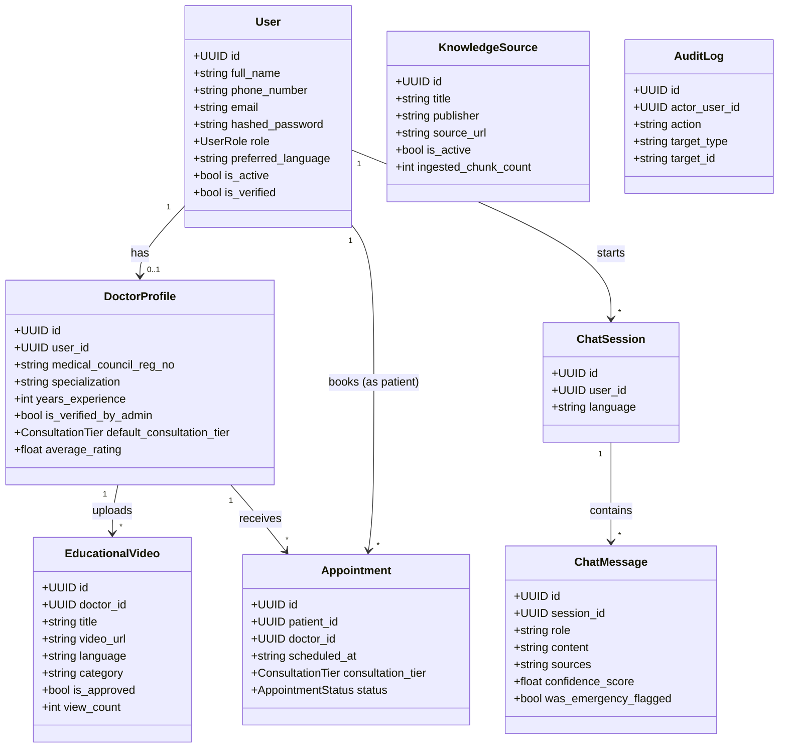

# Class Diagram — Core Domain

## Notes
- `DoctorProfile` is a 1:0..1 extension of `User` rather than a separate hierarchy — a doctor is a user first, with additional fields layered on. This matches the RBAC design: role changes on the same `User` row rather than creating a new identity.
- `AuditLog` intentionally has no outgoing relationships modeled — it references other entities by loosely-typed `target_type`/`target_id` string pairs rather than foreign keys, since it must be able to log actions against any entity type without schema coupling, and must remain insertable even if the referenced row is later deleted.
