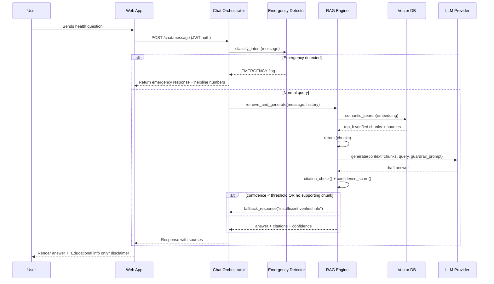

# RAG Query Sequence

## Design rationale
- Emergency detection runs **before** RAG retrieval — cheaper, faster, and ensures no emergency query ever gets a "let me look that up" delay.
- If the RAG engine can't ground an answer in retrieved chunks above a confidence threshold, it **must** return a fallback rather than let the LLM improvise. This is the core hallucination-prevention mechanism.
