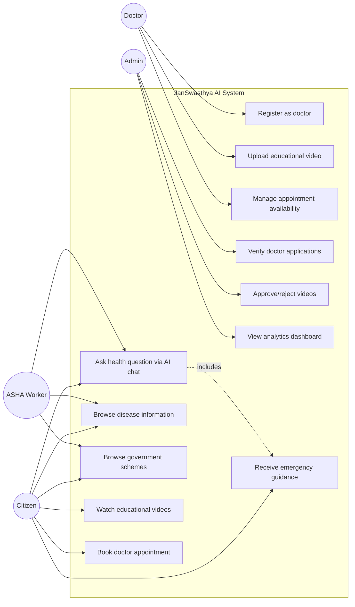

# Use Case Diagram

## Notes
- Emergency guidance (`UC12`) is modeled as an `<<includes>>` relationship on the chat use case, not a standalone trigger — it's a mandatory subflow evaluated on every chat message, not something a user separately invokes.
- ASHA workers use the same citizen-facing surfaces (chat, disease explorer, schemes) rather than a separate portal in v1 — a dedicated ASHA workflow (bulk patient outreach tracking, etc.) is flagged as future scope, not built in this phase, to keep scope realistic for 10 months.
